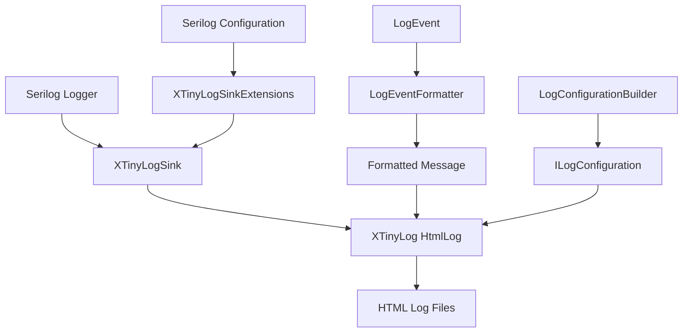

# Design Document

## Overview

The XTinyLog Serilog Sink is a custom Serilog sink that integrates XTinyLog's HTML logging capabilities into the Serilog ecosystem. This sink allows developers using Serilog to output their logs in XTinyLog's interactive HTML format without changing their existing logging code. The sink leverages XTinyLog's existing `HtmlLog` class and configuration system while providing seamless integration with Serilog's logging pipeline.

The design follows Serilog's sink architecture patterns and provides both synchronous and asynchronous logging capabilities. It supports all XTinyLog configuration options and includes proper error handling and fallback mechanisms.

## Architecture

### Component Overview



### Integration Points

1. **Serilog Integration**: The sink implements Serilog's `ILogEventSink` interface for synchronous logging and `IAsyncLogEventSink` for asynchronous operations
2. **XTinyLog Integration**: Uses XTinyLog's existing `HtmlLog` class and `ILogConfiguration` interface
3. **Configuration Integration**: Supports both Serilog's fluent configuration API and appsettings.json configuration

## Components and Interfaces

### Core Sink Implementation

#### XTinyLogSink
- **Purpose**: Main sink implementation that processes Serilog log events
- **Responsibilities**:
  - Receives Serilog `LogEvent` objects
  - Formats log events into appropriate messages
  - Maps Serilog log levels to XTinyLog log types
  - Delegates actual logging to XTinyLog's `HtmlLog` class
  - Handles exceptions gracefully without throwing to application

#### XTinyLogAsyncSink
- **Purpose**: Asynchronous version of the sink for high-performance scenarios
- **Responsibilities**:
  - Same as XTinyLogSink but with async/await support
  - Proper cancellation token handling
  - Async-safe resource management

### Configuration Components

#### XTinyLogSinkConfiguration
- **Purpose**: Configuration class that wraps XTinyLog's `ILogConfiguration`
- **Properties**:
  - `LogDirectory`: Directory for log files
  - `ApplicationName`: Application name for log organization
  - `MaxFileSize`: Maximum file size before archiving
  - `FileName`: File naming function
  - `IncludeProperties`: Whether to include structured properties in output
  - `PropertyFormat`: How to format structured properties

#### XTinyLogSinkExtensions
- **Purpose**: Serilog configuration extensions for fluent API
- **Methods**:
  - `WriteTo.XTinyLog()`: Basic configuration
  - `WriteTo.XTinyLog(Action<XTinyLogSinkConfiguration>)`: Custom configuration
  - `WriteTo.XTinyLogAsync()`: Async sink configuration

### Formatting Components

#### LogEventFormatter
- **Purpose**: Formats Serilog log events for XTinyLog consumption
- **Responsibilities**:
  - Renders message templates with property values
  - Formats structured properties for HTML display
  - Handles exception formatting with stack traces
  - Escapes HTML characters in log messages

#### LogLevelMapper
- **Purpose**: Maps Serilog log levels to XTinyLog log types
- **Mapping**:
  - `Verbose` → `Debug`
  - `Debug` → `Debug`
  - `Information` → `Info`
  - `Warning` → `Warning`
  - `Error` → `Error`
  - `Fatal` → `Error`

## Data Models

### Configuration Model

```csharp
public class XTinyLogSinkConfiguration
{
    public string LogDirectory { get; set; }
    public string ApplicationName { get; set; }
    public long MaxFileSize { get; set; }
    public Func<string> FileName { get; set; }
    public bool IncludeProperties { get; set; } = true
    public PropertyFormatMode PropertyFormat { get; set; } = PropertyFormatMode.Inline
}

public enum PropertyFormatMode
{
    Inline,     // Properties rendered inline with message
    Structured, // Properties rendered as structured data
    Hidden      // Properties not included in output
}
```

### Internal Models

The sink will use XTinyLog's existing `LogTypeEnum` and `ILogConfiguration` interfaces without modification. Log events will be converted to simple string messages that XTinyLog can process.

## Error Handling

### Sink-Level Error Handling
- **Principle**: Never throw exceptions to the application from the sink
- **Strategy**: Use try-catch blocks around all operations
- **Fallback**: Leverage XTinyLog's existing fallback logging mechanisms
- **Internal Logging**: Use XTinyLog's internal logger for sink diagnostics

### Configuration Error Handling
- **Validation**: Validate configuration during sink creation
- **Clear Messages**: Provide descriptive error messages for configuration issues
- **Defaults**: Use sensible defaults when possible
- **Early Failure**: Fail fast during configuration rather than at runtime

### File System Error Handling
- **Delegation**: Rely on XTinyLog's existing file system error handling
- **Transparency**: Allow XTinyLog's fallback mechanisms to work naturally
- **Logging**: Log configuration and setup errors through XTinyLog's internal logging

## Testing Strategy

### Unit Testing
- **Sink Behavior**: Test log event processing and formatting
- **Configuration**: Test configuration validation and builder patterns
- **Error Handling**: Test error scenarios and fallback behavior
- **Level Mapping**: Test Serilog to XTinyLog level mapping

### Integration Testing
- **End-to-End**: Test complete logging pipeline from Serilog to HTML files
- **Configuration Sources**: Test both code and appsettings.json configuration
- **Async Operations**: Test async sink behavior and cancellation
- **File Operations**: Test file creation, archiving, and error scenarios

### Performance Testing
- **Throughput**: Measure logging throughput under load
- **Memory Usage**: Monitor memory usage during extended logging
- **Async Performance**: Compare sync vs async sink performance
- **Overhead**: Measure sink overhead compared to other Serilog sinks

## Design Decisions and Rationales

### 1. Separate Sync and Async Sinks
**Decision**: Implement both `ILogEventSink` and `IAsyncLogEventSink` as separate classes
**Rationale**: 
- Provides optimal performance for both scenarios
- Avoids async overhead when not needed
- Follows Serilog best practices
- Allows users to choose appropriate performance characteristics

### 2. Delegate to XTinyLog HtmlLog
**Decision**: Use XTinyLog's existing `HtmlLog` class rather than reimplementing logging logic
**Rationale**:
- Maintains consistency with XTinyLog behavior
- Leverages existing error handling and fallback mechanisms
- Reduces code duplication and maintenance burden
- Ensures feature parity with direct XTinyLog usage

### 3. Message Formatting Strategy
**Decision**: Format Serilog message templates and properties into plain text for XTinyLog
**Rationale**:
- XTinyLog expects simple string messages
- Preserves structured logging information in readable format
- Avoids complex HTML generation in the sink
- Maintains XTinyLog's HTML formatting control

### 4. Configuration Wrapper Approach
**Decision**: Create a configuration wrapper rather than directly exposing XTinyLog configuration
**Rationale**:
- Provides Serilog-specific configuration options
- Allows future extension without breaking changes
- Maintains clear separation of concerns
- Enables sink-specific features like property formatting

### 5. Error Handling Philosophy
**Decision**: Never throw exceptions from the sink to the application
**Rationale**:
- Follows Serilog sink best practices
- Prevents logging failures from crashing applications
- Leverages XTinyLog's robust fallback mechanisms
- Maintains application stability

### 6. Package Structure
**Decision**: Create separate NuGet package for the Serilog sink
**Rationale**:
- Keeps XTinyLog core lightweight
- Allows independent versioning and updates
- Follows separation of concerns principle
- Enables optional dependency on Serilog